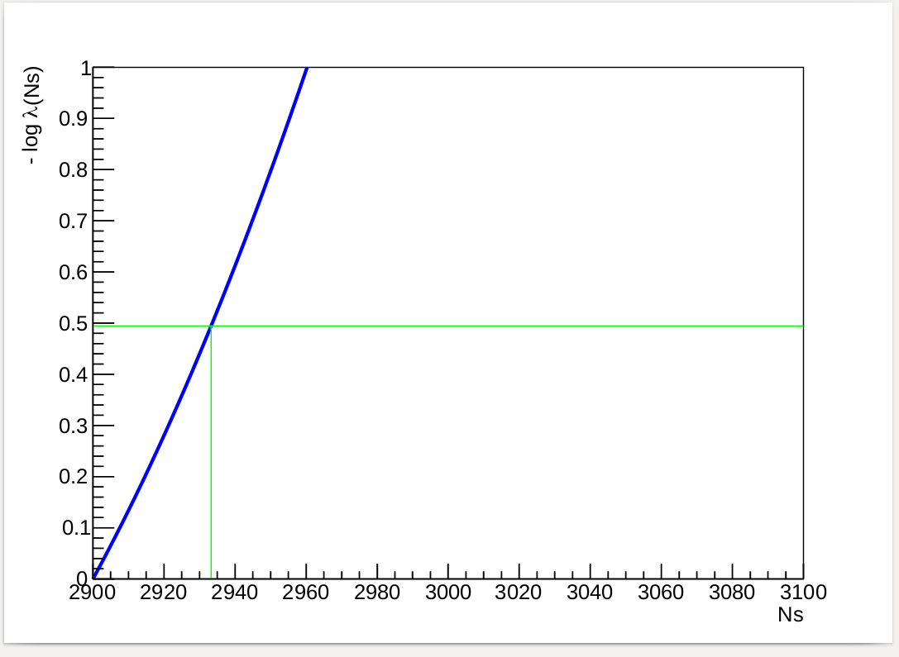
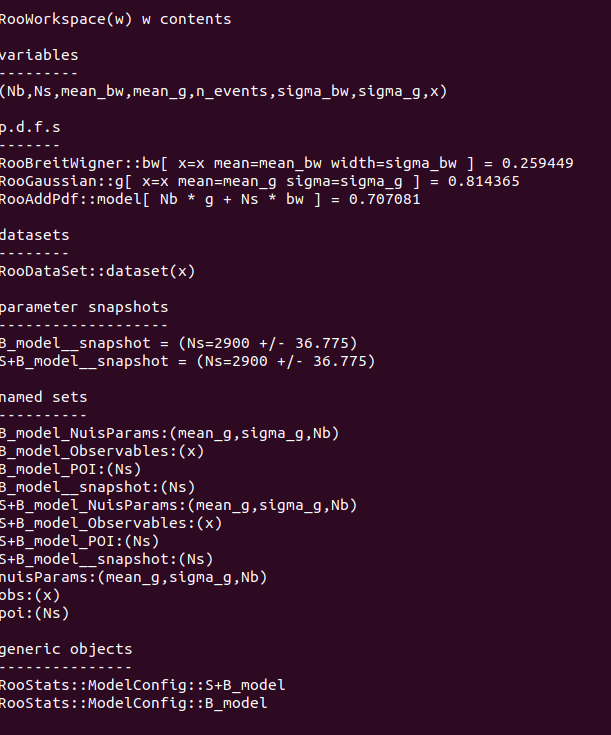
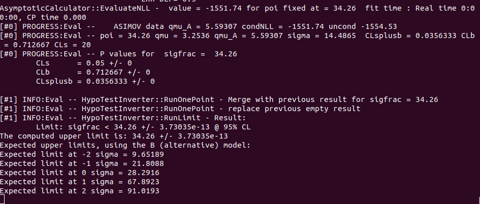

# Signal-plus-Background Inference with RooFit and RooStats

ROOT macros that fit a Breit–Wigner (signal) plus Gaussian (background) model to a one-dimensional distribution and then run the standard inference steps on it: an extended likelihood fit, a workspace with background-only and signal-plus-background hypotheses, a profile-likelihood interval, an asymptotic discovery significance, and a CLs upper limit on a toy example.

> **Status.** A cleaned-up collection of exercises.

## Overview

The repository walks through one analysis chain, from a plain fit to a hypothesis test:

```
fit_sig_bkg.C                     simple fit, signal fraction                  (testtree.root)

fit_extended.C ──► make_modelconfig.C ──┬─► profile_likelihood.C               (testtree.root)
  extended fit       B and S+B models   └─► discovery_from_workspace.C
  + workspace

discovery_standalone.C            the whole chain in one macro                  (treeForHypoTest.root)

cls_limit_toy.C                   CLs upper limit on generated toy data         (no input file)
```

## Statistical model

All macros that use the data work with the observable `x6` (a branch of the input tree, range 0–9):

- **signal:** Breit–Wigner PDF with position `mean_bw` and width `sigma_bw`
- **background:** Gaussian PDF with `mean_g` and `sigma_g`

The components are combined either with a signal fraction (`fit_sig_bkg.C`) or as an *extended* sum with yields (`Ns`, `Nb` in `fit_extended.C`; `frac_sg`, `frac_b` in `discovery_standalone.C`, where the "frac" names are in fact yields).

## Macros

| Macro | What it does | Reads | Writes |
|---|---|---|---|
| `fit_sig_bkg.C` | Unbinned fit of Breit–Wigner + Gaussian with a signal fraction; plots data, total and components. | `testtree.root` | `fit_sig_bkg.pdf` |
| `fit_extended.C` | Extended fit (yields `Ns`, `Nb`, Minuit2); builds a `RooWorkspace` with data and model. | `testtree.root` | `fit_extended.pdf`, `workspace_extended_fit.root` |
| `make_modelconfig.C` | Defines `B_model` (Ns = 0) and `S+B_model` (Ns = 50) as `ModelConfig`s. Nuisance parameters: `mean_g`, `sigma_g`, `Nb`; `mean_bw` and `sigma_bw` are held constant. | `workspace_extended_fit.root` | `workspace_modelconfig.root` |
| `profile_likelihood.C` | 68 % profile-likelihood interval on `Ns` (`ProfileLikelihoodCalculator`). | `workspace_modelconfig.root` | `profile_likelihood.pdf` |
| `discovery_from_workspace.C` | Asymptotic one-sided discovery test (`AsymptoticCalculator`) from the stored `ModelConfig`s. | `workspace_modelconfig.root` | console output |
| `discovery_standalone.C` | Fit, `ModelConfig`s and asymptotic discovery test in one macro, on a binned copy of the data. | `treeForHypoTest.root` | `discovery_standalone.pdf`, console output |
| `cls_limit_toy.C` | Toy study: Landau "signal" plus Gaussian "background", 500 generated events, 95 % CLs upper limit with `HypoTestInverter` (asymptotic, one-sided). Uses generated data, not the trees. | none | console output |

The macros follow the structure of the RooFit and RooStats tutorials distributed with ROOT.

## Requirements

- [ROOT](https://root.cern) 6.x with RooFit and RooStats. The version used in the course is not recorded; any ROOT 6 release with RooStats is expected to work, but this has not been checked.
- The macros are meant to be run in the ROOT interpreter.

## Repository structure

```
.
├── macros/                 # the seven ROOT macros
└── data/                   # course-provided input trees

```

## How to run

The macros read their input from, and write their output to, the current directory, so run them from a separate working directory:

```bash
mkdir -p work && cd work
ln -s ../data/testtree.root ../data/treeForHypoTest.root .

root -l -b -q ../macros/fit_sig_bkg.C
root -l -b -q ../macros/fit_extended.C
root -l -b -q ../macros/make_modelconfig.C
root -l -b -q ../macros/profile_likelihood.C
root -l -b -q ../macros/discovery_from_workspace.C
root -l -b -q ../macros/discovery_standalone.C
root -l -b -q ../macros/cls_limit_toy.C
```

- `fit_extended` → `make_modelconfig` → `profile_likelihood` / `discovery_from_workspace` must run in this order, because each reads the workspace written by the previous step.
- Run the macros interpreted, without a trailing `+`; they rely on ROOT's automatic header loading for the RooStats classes.

## Example results

### Signal-plus-background fit
 

 
RooPlot of `x6` (0–9): data points, total model (black solid), and dashed component curves. The figure has no legend and no archived console output, so the assignment of the red/blue/green dashed curves is inferred, not recorded: red is most likely the Breit–Wigner signal, blue the Gaussian background; the identity of the green curve is not established here. The screenshot is attributed to `discovery_standalone.C` (the `x6` variable and the bin width of 0.09 = 9/100 are consistent with it), but the macro that produced it was not recorded.
 
### Profile likelihood in `Ns`
 

 
Output of `profile_likelihood.C`: −log λ as a function of `Ns` over 2900–3100, with a horizontal green line near 0.5 and a vertical green line at its crossing with the curve, at roughly `Ns` ≈ 2933 (read off the plot, not a printed value). **The curve is lowest at the left edge of the scan, `Ns` = 2900, which is the lower bound set in `fit_extended.C`.** The minimum is therefore at the parameter bound and the plot does not show a two-sided interval.
 
The workspace printed by the same macro (`w->Print()`):
 

 
It lists the variables, the PDFs `bw` (Breit–Wigner), `g` (Gaussian) and `model` (`Nb * g + Ns * bw`), the dataset, the `B_model` and `S+B_model` `ModelConfig`s with nuisance parameters `mean_g`, `sigma_g`, `Nb`, and the parameter snapshots, which show `Ns = 2900 ± 36.775` for both models (again the lower bound).
 
### CLs upper limit (toy example)
 

 
Console output of `cls_limit_toy.C` (`HypoTestInverter`, asymptotic, one-sided): upper limit `sigfrac < 34.26` at 95 % CL. The expected limits printed for the background-only model are 9.65189, 21.8088, 28.2916, 67.8923 and 91.0193 for −2σ, −1σ, 0σ, +1σ and +2σ. The data are generated by the macro (500 events, no fixed seed), so these numbers change from run to run. The final scan point shows CL_s = 0.05 by construction of the limit search.

